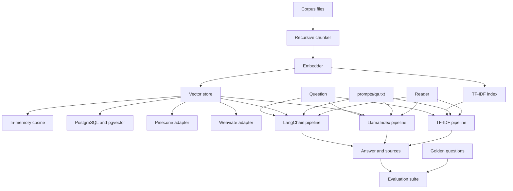

# Meridian Archive QA

A small retrieval-augmented question-answering service over a fictional harbor archive. It ingests documents, retrieves passages, answers from a prompt file, and scores the result without an API key.

The default local embedder is [sentence-transformers](https://www.sbert.net/) (`all-MiniLM-L6-v2`). When that package is not installed, or when `RAGQA_EMBEDDER=hash`, a deterministic hashing embedder is used instead. The reader is an extractive model unless `OPENAI_API_KEY` or `ANTHROPIC_API_KEY` is set.

## Architecture



Ingestion splits each file into overlapping chunks, embeds them, and upserts them. A question is embedded for the dense pipelines, or vectorized with TF-IDF for the baseline. All three pipelines fill `prompts/qa.txt` and call the same reader. LangChain runs that as an LCEL chain over a custom retriever. LlamaIndex runs it through a custom `BaseRetriever`, `PromptTemplate`, and `CustomLLM`.

## Run with Docker

`docker compose up --build` starts PostgreSQL with pgvector and the API. The API container installs sentence-transformers and ingests `data/corpus` on startup.

```bash
docker compose up --build
curl -s localhost:8000/health
curl -s localhost:8000/query \
  -H 'content-type: application/json' \
  -d '{"question":"When was the Meridian lighthouse lantern first lit?"}'
```

The database password in `docker-compose.yml` is for this local demo.

## Run without Docker

Python 3.11 or newer.

```bash
python -m venv .venv
source .venv/bin/activate
pip install -e ".[dev]"
RAGQA_EMBEDDER=hash RAGQA_LLM=extractive \
  uvicorn ragqa.api.app:create_app --factory --port 8000
```

Semantic embeddings:

```bash
pip install -e ".[embeddings]"
uvicorn ragqa.api.app:create_app --factory --port 8000
```

Hosted adapters, used only when selected:

```bash
pip install -e ".[hosted]"
```

With a key in the environment and `RAGQA_LLM=auto`, the service uses OpenAI if `OPENAI_API_KEY` is set, otherwise Anthropic if `ANTHROPIC_API_KEY` is set, otherwise the extractive reader.

## HTTP API

| Method | Path | Purpose |
| --- | --- | --- |
| `GET` | `/health` | Store, embedder, reader, and chunk count |
| `POST` | `/ingest` | Add JSON documents or a directory, or reload the bundled corpus |
| `POST` | `/query` | Answer a question |

`pipeline` is `langchain` (default), `llamaindex`, or `tfidf`. `k` is from 1 to 20.

```bash
curl -s localhost:8000/query \
  -H 'content-type: application/json' \
  -d '{"question":"Who does the ferry compact name as arbitrator?","pipeline":"llamaindex","k":4}'
```

```bash
curl -s localhost:8000/ingest \
  -H 'content-type: application/json' \
  -d '{"documents":[{"document_id":"note","text":"The spare hawser is in locker B."}]}'
```

## Embeddings, stores, and readers

| Piece | Options |
| --- | --- |
| Embeddings | `sentence-transformers` (default), `hash`, `openai` |
| Vector store | `memory` (default), `pgvector`, `pinecone`, `weaviate` |
| Reader | `auto`, `extractive`, `openai`, `anthropic` |

`hash` is a signed feature hash. It needs no download, which is what CI uses. `sentence-transformers` is the local semantic model. OpenAI embeddings are used only when `RAGQA_EMBEDDER=openai` and a key is present.

pgvector stores vectors in PostgreSQL (`vector` column, cosine distance, HNSW index). The Pinecone adapter maps records onto `Index.upsert`, `query`, `fetch`, and `delete`. The Weaviate adapter maps them onto a collection with self-provided vectors (`near_vector`, `insert`, `fetch_objects`). Both hosted adapters raise a clear error until their environment variables and client packages are present. See `.env.example`.

Changing embedder dimension requires a new table. The pgvector store records the dimension in `ragqa_meta` and refuses to mix vectors of different sizes.

## Evaluation

`python -m ragqa.eval` answers every item in `data/golden/qa.json` with all three pipelines. The metrics are offline stand-ins for a RAGAS-style suite, so they run with no judge model:

| Metric | Definition |
| --- | --- |
| Faithfulness | Fraction of answer sentences whose content words are supported by the retrieved context. The fixed abstention is treated as faithful. |
| Answer relevance | Recall of the question's content words in the answer. Abstention scores 0. |
| Answer correctness | Token F1 against the reference sentence from the archive. |
| Retrieval hit rate | Fraction of questions whose expected document appears in the top k. |
| Context recall | Fraction of expected snippets present in the retrieved text. |

Reference answers are the supporting sentences in the corpus. The extractive reader copies the best-matching sentence, so correctness tracks whether retrieval surfaced that sentence.

Sample run with the hashing embedder, k = 4, 12 questions (`evals/results.json`):

| Pipeline | Faithfulness | Answer relevance | Answer correctness | Retrieval hit rate | Context recall | Mean latency (ms) |
| --- | ---: | ---: | ---: | ---: | ---: | ---: |
| langchain | 1.000 | 0.838 | 1.000 | 1.000 | 1.000 | 2.3 |
| llamaindex | 1.000 | 0.838 | 1.000 | 1.000 | 1.000 | 0.8 |
| tfidf | 1.000 | 0.838 | 1.000 | 1.000 | 1.000 | 0.8 |

On this archive the three pipelines share one index, one prompt, and one reader, and the questions use distinctive names and figures, so the quality columns match. Answer relevance stays below 1 because a good sentence does not repeat every question word. Regenerate the file with:

```bash
python -m ragqa.eval --embedder hash --output evals/results.json --min-hit-rate 1.0
```

`--min-hit-rate 1.0` exits non-zero if any pipeline misses a golden document. CI runs that command.

## Tests

```bash
pytest
```

Unit tests cover chunking, the hashing and OpenAI embedders, the sentence-transformers wrapper, the extractive reader, the memory store, the Pinecone and Weaviate adapters, both orchestration pipelines, the HTTP API, and the golden-set gate. The pgvector tests run when `DATABASE_URL` points at a database with the extension installed.

GitHub Actions (`.github/workflows/ci.yml`) starts `pgvector/pgvector:pg16`, runs `pytest`, then runs the evaluation and uploads `evals/ci_results.json`.

## Layout

```
data/corpus/          archive documents
data/golden/qa.json   questions, reference sentences, expected snippets
prompts/qa.txt        the only answer prompt
src/ragqa/            API, ingestion, stores, pipelines, evaluation
tests/                pytest
evals/results.json    last offline eval report
docker-compose.yml    API plus PostgreSQL
```

## Configuration

Environment variables use the `RAGQA_` prefix. These names are also read without the prefix: `DATABASE_URL`, `OPENAI_API_KEY`, `ANTHROPIC_API_KEY`, `PINECONE_API_KEY`, `PINECONE_INDEX`, `WEAVIATE_URL`, `WEAVIATE_API_KEY`.

| Variable | Default | Role |
| --- | --- | --- |
| `RAGQA_VECTOR_STORE` | `memory` | `memory`, `pgvector`, `pinecone`, `weaviate` |
| `RAGQA_EMBEDDER` | `sentence-transformers` | `sentence-transformers`, `hash`, `openai` |
| `RAGQA_EMBEDDING_MODEL` | `all-MiniLM-L6-v2` | sentence-transformers model name |
| `RAGQA_LLM` | `auto` | `auto`, `extractive`, `openai`, `anthropic` |
| `RAGQA_AUTO_INGEST` | `1` | ingest `data/corpus` when the store is empty |
| `DATABASE_URL` | empty | PostgreSQL URL for pgvector |

## License

MIT, copyright Arpan Bom.
